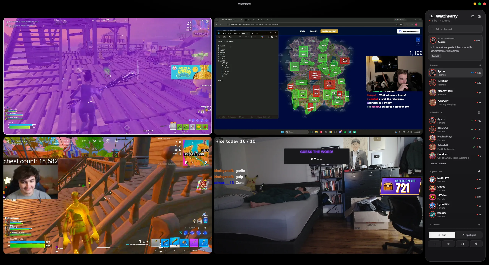
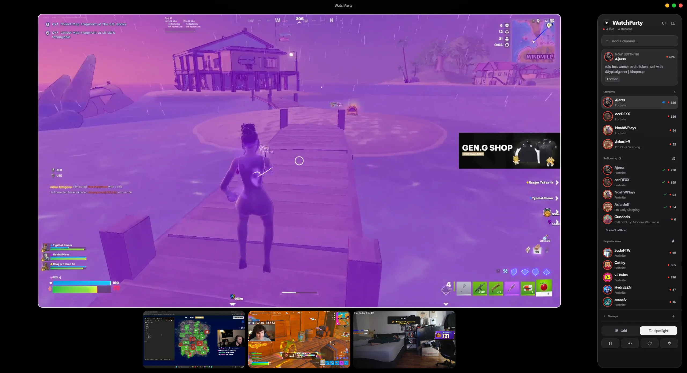
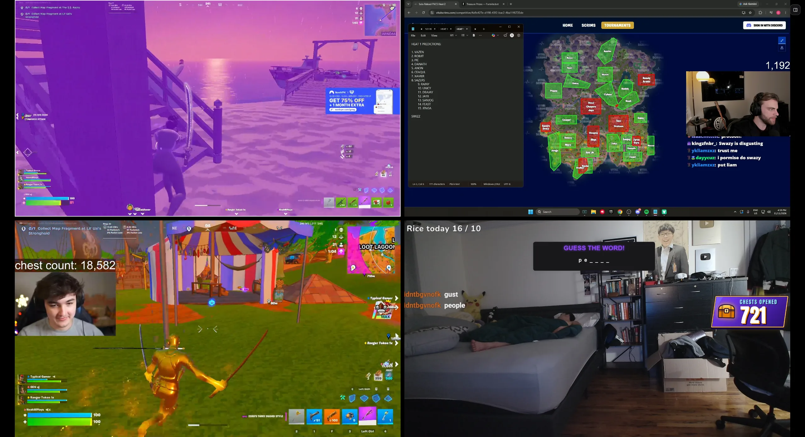

  

<h1 align="center">WatchParty</h1>

  <b>Watch several Twitch streams side by side, with chat, in a clean macOS-style app for Windows.</b>

  

  

## Watch everyone at once
- Add channels by name or link, or several at once: `shroud, xqc, lirik`
- **Grid** gives every stream the same space. **Spotlight** makes one big, with the rest lined up beside or below it
- In Spotlight, **click a small stream** to make it the main one and the one you hear
- **One sound at a time** (optional). A white ring shows which stream you're hearing
- Hover a stream for its name, title, a LIVE badge with viewers, and quick buttons: listen, chat, spotlight, fill the window

  

## One tidy panel
- Everything lives in one panel on the right: **Now listening**, your streams, **who you follow that's live**, **popular channels right now**, and saved **groups**
- Open **chat** and it takes the panel's place. The back arrow brings the panel back
- Offline streams step aside and pop back in when they go live, with go-live alerts for people you follow

## Full window
Press **Ctrl+B** (or the panel button) and the streams fill the whole window, edge to edge. A small button in the corner brings the panel back.

  

**Shortcuts:** `1`–`9` listen · `F` fill · `C` chat · `B` browse · `Ctrl+B` panel

## Install
1. Download **WatchParty-Setup-….exe** from the [latest release](https://github.com/saintzdid12/watchparty/releases/latest) (or the [download page](https://saintzdid12.github.io/watchparty)). There's also a **Portable** version if you'd rather not install anything.
2. Windows may say *"Windows protected your PC"* the first time. Click **More info → Run anyway**.
3. Add a few channels. Sign in to Twitch (optional) to see who you follow and to chat.

**Needs:** Windows 10/11 (64-bit).

## Privacy
- No Twitch API key and no account of ours. Live info is read from the Twitch players themselves.
- Twitch runs in its own sandboxed session that can only load twitch.tv pages and has no access to the rest of the app or your files.
- Your Twitch sign-in stays on your PC. Settings and stream lists are saved locally.

---

WatchParty isn't affiliated with or endorsed by Twitch. Streams and chat are Twitch's own players and pages.
